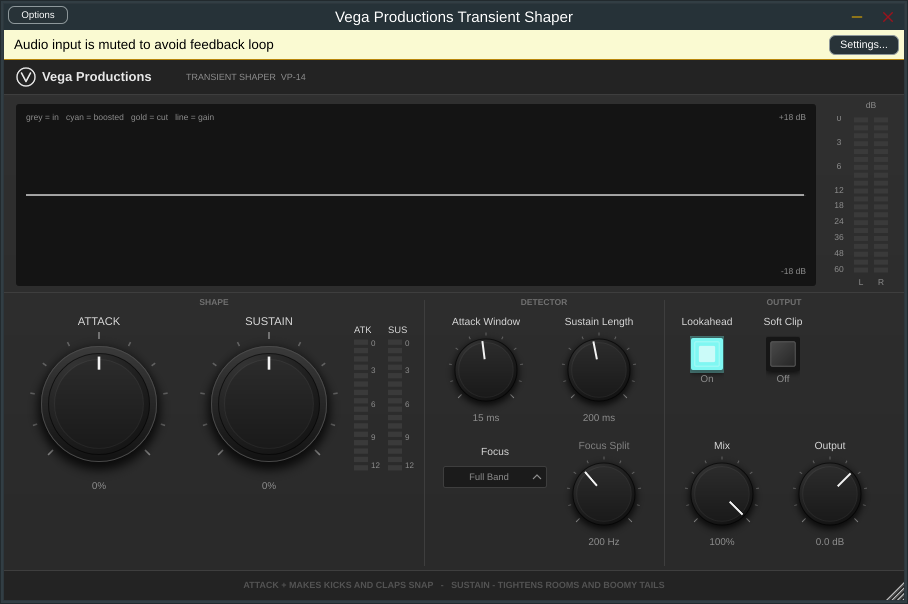

# Vega Productions Transient Shaper (VP-14)

Add or remove punch and tail — level-independent, so it works the same on quiet and loud hits.



## Download
- **Windows (FL Studio):** https://github.com/DJVega70/vega-transient/releases/latest/download/VegaProductions-TransientShaper-Windows-VST3.zip
- **macOS:** https://github.com/DJVega70/vega-transient/releases/latest/download/VegaProductions-TransientShaper-macOS-VST3-AU.zip

## Features
- **Attack** ±18 dB: make kicks and claps snap, or soften harsh hits.
- **Sustain** ±18 dB: tighten boomy kicks and roomy drums, or bring out tails.
- **Attack Window** and **Sustain Length** tune how the detector hears your drums.
- **Focus:** shape only the lows (kick body) or only the highs (clicks, claps, hats) with an adjustable split.
- **Lookahead** (3 ms, latency-compensated) so the boost lands on the very first sample of the hit.
- **Soft Clip** to catch boosted peaks, Mix, Output, live scope showing input and the gain being applied.
- Steady sounds (pads, sustained bass) are left alone.

## Building
```
cmake -B build -DVEGA_TESTS=ON
cmake --build build --config Release --target VegaTransient_VST3 VegaTransientTest
```
